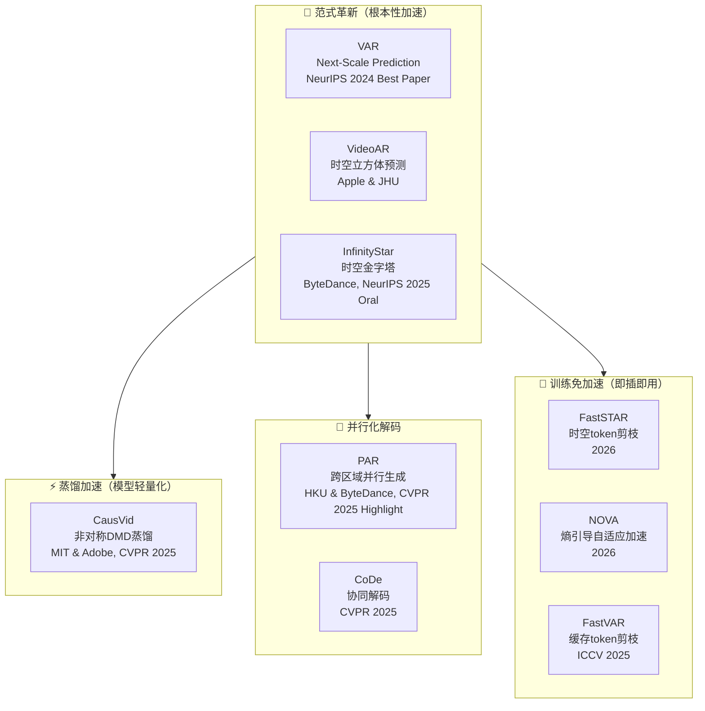
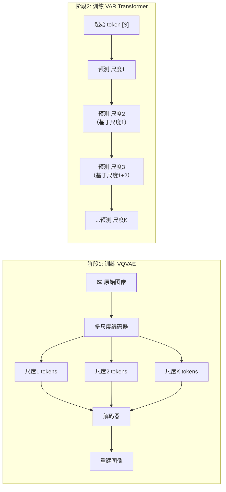
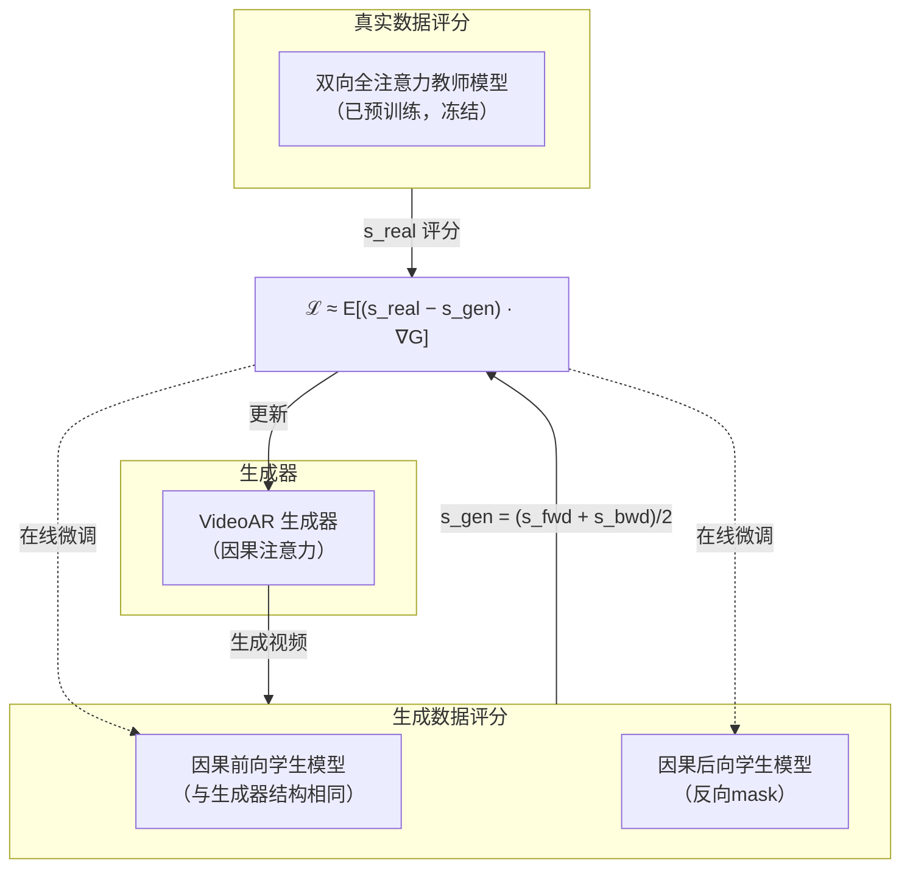
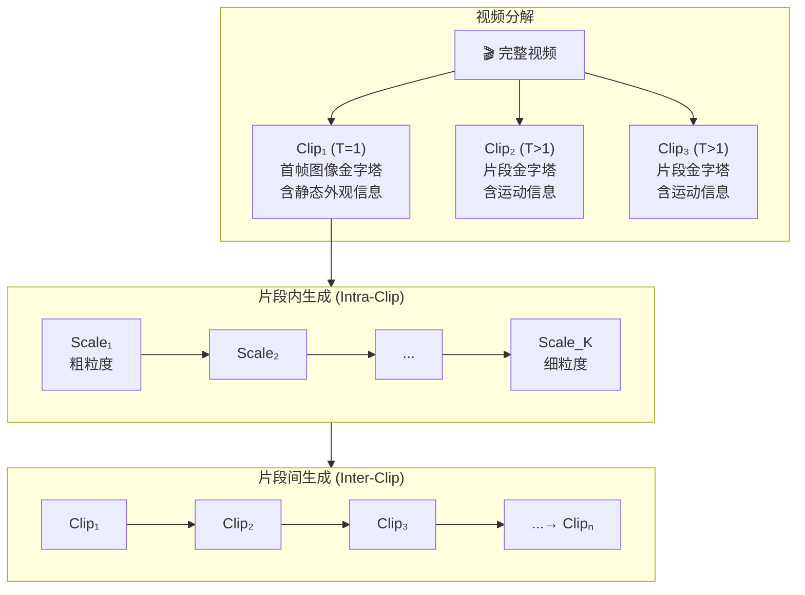
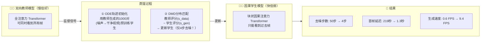
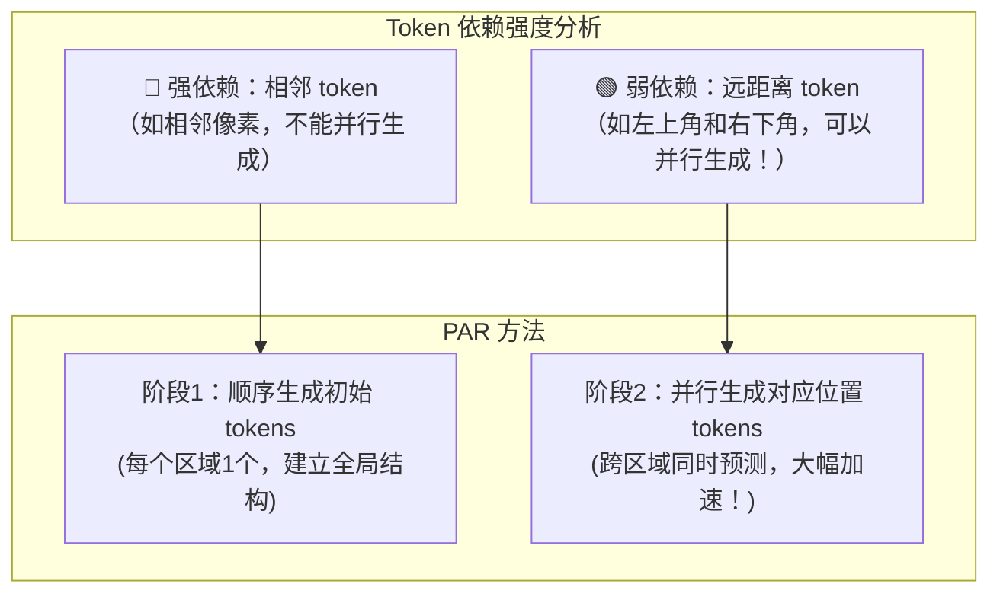
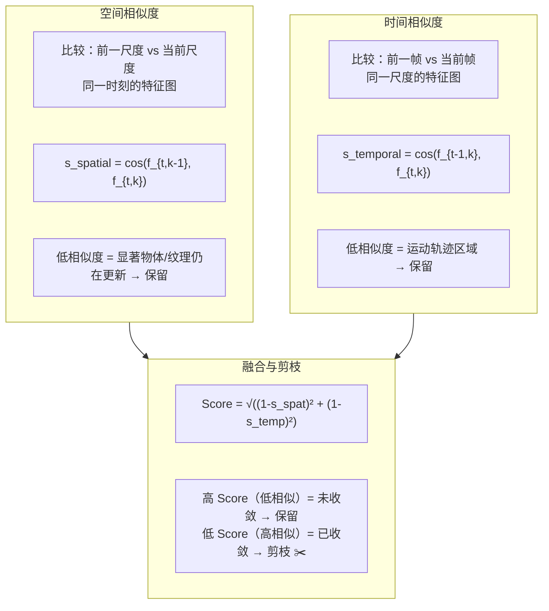
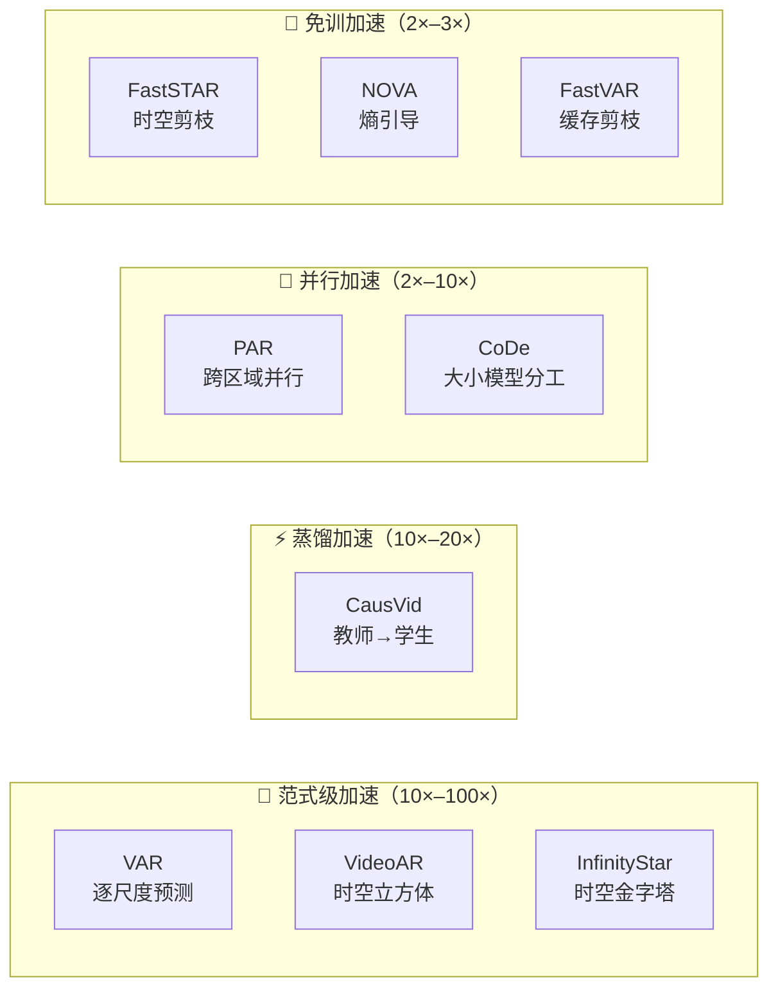

# 自回归视频生成加速：重要工作综述

> 调研时间：2026年7月 | 覆盖范围：2024–2026年顶会/顶刊论文

---

## 一、背景：为什么需要加速自回归视频生成？

### 1.1 什么是自回归（Autoregressive, AR）生成？

自回归生成的核心思想很简单——**像写作文一样，一个字一个字地"写"出图像或视频**。模型根据已经生成的内容，预测下一个 token（可以理解为画面的最小单元），直到完成整幅画面。

```
传统逐token生成（慢 🐢）:
Step 1: [t1]
Step 2: [t1][t2]
Step 3: [t1][t2][t3]
...
Step N: [t1][t2][t3]...[tN]  ← 完成！
```

### 1.2 AR 生成的优劣势

| 优势 ✅ | 劣势 ❌ |
|---------|---------|
| 天然支持变长生成 | 逐 token 生成，速度慢 |
| KV-Cache 可复用，内存 O(1) | token 数量巨大（视频尤甚） |
| 与 LLM 架构统一，Scaling Law 成立 | 传统 raster-scan 破坏 2D 结构 |
| 流式输出，边生成边播放 | 误差累积（exposure bias） |

一段 5 秒 720p 视频可能需要数万甚至数十万个 token，如果逐 token 生成，延迟将无法接受。**因此，加速自回归视频生成成为近年来的研究热点。**

### 1.3 加速路线图总览



---

## 二、范式革新：重新定义"预测什么"和"怎么预测"

### 2.1 VAR — 自回归视觉生成的奠基之作

> **论文**: Visual Autoregressive Modeling: Scalable Image Generation via Next-Scale Prediction
> **作者**: Keyu Tian et al. (北大 & 字节跳动)
> **发表**: NeurIPS 2024 🏆 **Best Paper**
> **代码**: [github.com/FoundationVision/VAR](https://github.com/FoundationVision/VAR)

#### 核心思想

传统的视觉自回归模型把图像像文字一样压扁成一维序列，逐 token 预测。这完全**破坏了图像的 2D 结构**，而且计算复杂度高达 O(n⁶)。

VAR 的革命性改变是：**不是预测"下一个 token"，而是预测"下一张更大尺度（分辨率）的整张图"**。

```
传统 AR（逐 token 预测）：              VAR（逐尺度预测）：
                                        
  1  2  3  4  5                          Scale 1:  ■           (1×1, 粗结构)
  6  7  8  9 10              →           Scale 2:  ■■■         (2×2)
 11 12 13 14 15                          Scale 3:  ■■■■■       (4×4)
 16 17 18 19 20                          Scale 4:  ■■■■■■■■■   (8×8, 细节)
 ↑ 按 raster-scan 顺序逐个生成              ↑ 每个尺度内部并行生成！
```

#### 架构设计



#### 为什么快？

- **尺度内并行**：同一尺度的所有 token（比如 16×16=256 个）一次性并行生成
- **尺度数远小于 token 数**：比如 10 个尺度 vs 4096 个 token
- **计算复杂度**：从 O(n⁶) 降至 O(n⁴)

#### 关键结果 (ImageNet 256×256)

| 指标 | 传统 AR | VAR | 提升 |
|------|---------|-----|------|
| FID ↓ | 18.65 | **1.73** | ~10× |
| IS ↑ | 80.4 | **350.2** | ~4× |
| 推理速度 | 1× | **~20×** | 20× |

> 💡 **历史意义**：VAR 首次让 GPT 风格的自回归模型在图像生成上**全面超越扩散模型**，并且首次在视觉生成领域验证了 Scaling Law 和零样本泛化能力。

---

### 2.2 VideoAR — 将 VAR 思想拓展到视频的时空立方体

> **论文**: Autoregressive Video Generation beyond Next Frames Prediction
> **作者**: Sucheng Ren et al. (Apple & Johns Hopkins University)
> **发表**: arXiv:2509.24081, 2025年9月

#### 核心问题：一帧一帧地预测是最优的吗？

几乎所有自回归视频模型都把"帧"当作预测的基本单位——第 t 帧基于前 t-1 帧生成。但 VideoAR 问了一个根本性问题：**帧真的是合适的预测单位吗？**

答案是否定的。VideoAR 提出用**时空立方体（Spatiotemporal Cubes）**作为预测单元——每个单元跨越时间和空间两个维度：

```
逐帧预测（传统方式）：              时空立方体预测（VideoAR）：
                                    
 Frame 1  Frame 2  Frame 3         ┌─────────┐
┌──────┐ ┌──────┐ ┌──────┐         │ C1 │ C2 │    ← 每个 Cube =
│      │ │      │ │      │         │    │    │       同时覆盖 时间×空间
│  t1  │→│  t2  │→│  t3  │→...     ├────┼────┤
│      │ │      │ │      │         │ C3 │ C4 │
└──────┘ └──────┘ └──────┘         └─────────┘
 ↑ 只有时间维度的信息流动           ↑ 时空两个维度的信息同时流动！
```

#### 四种预测单元对比

VideoAR 构建了一个统一框架，支持四种预测单元：

| 预测单元 | 形状 | 步数 | 思路 |
|---------|------|------|------|
| **Frame（帧）** | H×W | T | 逐帧预测，仅时间流动 |
| **Key-Detail Frame** | T/k × H×W | k | 先预测关键帧，再插值中间帧 |
| **Scale（尺度）** | 下采样金字塔 | L | 从粗到细逐尺度细化（VAR 方式） |
| **Cube（立方体）** 🏆 | kt×kh×kw | (T/kt)(H/kh)(W/kw) | 时空联合预测 |

消融实验证明，**2×2×2 的立方体配置**取得了最佳效果（VBench 总分 84.87）。

#### 训练方法：对称分布匹配蒸馏（Symmetric DMD）



核心技巧：用一个**双向全注意力模型**（能看全部帧）监督**两个因果模型**（一个正向、一个反向），两者的评分平均后作为"假数据"的评分。这样既保持了因果性（可流式推理），又缩小了与全注意力教师的能力差距。

#### 长视频生成：KV-Cache 流式推理

```
时间 →
┌─────────────────────────────────────────────┐
│  Cube₁  │ Cube₂ │ Cube₃ │ Cube₄ │ ... │Cubeₙ│
│  (计算) │→ 重用 │→ 重用 │→ 重用 │     │      │
│  KV缓存 │ KV₁   │ KV₁,₂ │ KV₁,₂,₃│    │      │
└─────────────────────────────────────────────┘
    ↑ 早期缓存被逐渐丢弃，保持上下文长度恒定
    ↑ 每步成本与视频总长度无关！
```

#### 关键结果

| 模型 | 类型 | 参数量 | VBench 总分 | FPS |
|------|------|--------|-------------|-----|
| **VideoAR** | AR | 1.3B | **84.87** | **16.4** |
| Wan2.1 | Diffusion | 1.3B | 83.88 | 0.78 |
| CausVid | AR | 1.3B | 81.46 | 17.0 |
| SkyReels-V2 | AR | 1.3B | 82.67 | 0.49 |
| MAGI-1 | AR | 4.5B | 79.18 | 0.19 |
| HunyuanVideo | Diffusion | 13B | 82.80 | 0.22 |

- 🏆 **VBench 最高分** 84.87，超越所有扩散模型和 AR 模型
- ⚡ 比同参数量的 Wan2.1 **快 21 倍**
- 📏 **零样本**支持分钟级长视频，无需长视频训练数据
- 👥 用户偏好：63.3% 的人相比其他模型更偏好 VideoAR

---

### 2.3 InfinityStar — 工业级 720p 视频的自回归生成

> **论文**: InfinityStar: Unified Spacetime AutoRegressive Modeling for Visual Generation
> **作者**: ByteDance (字节跳动)
> **发表**: NeurIPS 2025 **Oral** | arXiv:2511.04675
> **代码**: 已开源

#### 核心思想：时空金字塔

InfinityStar 将视频分解为**首帧图像金字塔**（编码静态外观）和**后续片段金字塔**（编码动态运动），通过两阶段生成实现任意长视频：



#### 四大技术创新

**① 知识继承（Knowledge Inheritance）**

不从头训练离散 tokenizer，而是继承预训练的连续视频 VAE 权重，插入一个**无参数的二值球面量化器（BSQ）**。这解决了离散 tokenizer 的"冷启动"问题。

```
连续VAE权重 → 插入BSQ量化器 → 微调 → 离散tokenizer
PSNR: 29.1（从头训练）→ 33.4（知识继承）✨
```

**② 随机量化深度（SQD: Stochastic Quantizer Depth）**

训练时随机丢弃后几个尺度的量化，强制早期尺度存储更多语义信息：

```
无SQD：早期尺度 → 模糊、信息量少
有SQD：早期尺度 → 清晰、语义丰富
```

**③ 语义尺度重复（SSR: Semantic Scale Repetition）**

在生成时将前 12 个语义尺度重复 3 次。这是**对 VBench 提升最大的单项技术**：

```
VBench 总分：75.72（无SSR）→ 81.28（有SSR）📈 +5.56
```

**④ 时空稀疏注意力（SSA: Spacetime Sparse Attention）**

每个新片段只关注前一片段的**最后一个（最粗糙的）尺度**：

```
完整注意力：
Clip₂ ← 关注 Clip₁ 的所有尺度 → 上下文长度 >10× 更长

SSA：
Clip₂ ← 仅关注 Clip₁ 的最粗尺度 → 内存节省 >40%，速度提升 1.5–2×
```

#### 关键结果

| 基准 | InfinityStar (8B) | 对比模型 |
|------|-------------------|---------|
| VBench（文生视频） | **83.74** | HunyuanVideo (13B): 83.24 |
| GenEval（文生图） | **0.79** | Infinity (2B): 0.73 |
| DPG（文生图） | **86.55** | FLUX-schnell (12B): 84.8 |
| 推理速度 (5s 720p) | **58s** (A100) | Wan2.1 (14B): 1864s → **32× 加速** |

- 🏆 第一个能生成**工业级 720p 视频**的离散 AR 模型
- ⚡ 比扩散方法快约 **10 倍**，比 Wan2.1 快 **32 倍**
- 🎯 在 VBench 上超越 HunyuanVideo（13B 扩散模型）
- 🧩 同一架构支持文生图、文生视频、图生视频、交互式长视频

---

## 三、蒸馏加速：让大模型"教"小模型

### 3.1 CausVid — 从 219 秒到 1.3 秒的流式视频生成

> **论文**: From Slow Bidirectional to Fast Causal Video Generators
> **作者**: Tianwei Yin et al. (MIT & Adobe)
> **发表**: CVPR 2025 | arXiv:2412.07772
> **项目页**: [causvid.github.io](https://causvid.github.io/)

#### 核心挑战

扩散模型生成视频质量好，但太慢了——需要对所有帧同时去噪，用户等好几分钟才能看到结果。CausVid 的目标是：**像看 YouTube 一样，边生成边播放**。

#### 方法：非对称分布匹配蒸馏



#### 关键技术细节

**① 块状因果注意力 + KV-Cache**

```
时间 →
Chunk 1 (帧1-16):  [双向自注意力] → 缓存KV
Chunk 2 (帧17-32): [只看Chunk1的缓存 + 本块内双向注意力] → 追加KV
Chunk 3 (帧33-48): [只看Chunk1+2的缓存 + 本块内双向注意力] → 追加KV
...
→ 推理时直接用FlashAttention做双向计算，因为KV-Cache已保证因果性！
```

**② 为什么不能用"对称"蒸馏？**

如果用因果教师蒸馏因果学生 → 教师本身就有误差累积，会把错误"教"给学生。CausVid 的**非对称**方案——用**双向教师**（无误差累积）监督**因果学生**——从根本上解决了这个问题。

消融实验证明了这一点：

| 配置 | Temporal Quality | Frame Quality | Text Alignment |
|------|-----------------|---------------|----------------|
| 因果教师蒸馏 + ODE初始化 | 91.9 | 61.7 | 28.2 |
| 双向教师蒸馏 + 无ODE初始化 | 93.4 | 60.6 | 29.4 |
| **双向教师蒸馏 + ODE初始化** ✅ | **94.7** | **64.4** | **30.1** |

#### 关键结果

| 指标 | 传统扩散模型 | CausVid |
|------|-------------|---------|
| 首帧延迟 | 219 秒 | **1.3 秒** |
| 生成速度 | 0.6 FPS | **9.4 FPS** |
| VBench-Long | - | **84.27**（当时最高） |
| 短视频质量 | - | 超越 CogVideoX-5B, MovieGen, Pyramid Flow |
| 训练开销 | - | 64×H100, 约2天 |

> 🎬 **零样本能力**：支持图像动画化、实时风格迁移、交互式叙事、流式视频翻译——全部无需额外训练。

---

## 四、并行化解码：打破"逐 token"的枷锁

### 4.1 PAR — 并行化自回归视觉生成

> **论文**: Parallelized Autoregressive Visual Generation
> **作者**: Yuqing Wang et al. (香港大学 & 字节跳动)
> **发表**: CVPR 2025 **Highlight** | arXiv:2412.15119

#### 核心洞察：并非所有 token 都互相依赖



#### 工作流程示意

假设将 24×24 的 token 网格划分为 2×2 个区域：

```
阶段1（顺序，4步）：                阶段2（并行，每步4个token）：
                                    
┌────┬────┐                        ┌────┬────┐
│ S₁ │ S₂ │                        │ P₁ │ P₂ │  ← 每步4个token同时生成！
├────┼────┤                        ├────┼────┤
│ S₃ │ S₄ │                        │ P₃ │ P₄ │
└────┴────┘                        └────┴────┘
 ↑ 顺序生成4个初始token              ↑ 组内双向注意力 + 组间因果注意力
   建立全局上下文                       兼容 KV-Cache 优化
```

#### 关键结果

| 配置 | 加速比 | 质量影响 |
|------|--------|---------|
| PAR-4x | **3.6×** | 质量可比 |
| PAR-16x | **9.5×** | 图像 FID <0.7 下降，视频 FVD <10 下降 |
| 延迟（PAR-4x）| 12.41s → 3.46s | A100 单卡 |

> 💡 **关键优势**：无需修改模型架构或 tokenizer，可直接应用于现有 AR 模型。

---

### 4.2 CoDe — 协同解码：大小模型分工

> **论文**: Collaborative Decoding Makes Visual Auto-Regressive Modeling Efficient
> **发表**: CVPR 2025

#### 核心思想

VAR 的多尺度特性天然适合分工：**大模型处理粗尺度（低频/结构），小模型处理细尺度（高频/细节）**。

```
传统 VAR（单模型处理所有尺度）：      CoDe（协同解码）：

  大模型 (全部尺度)                    大模型 (drafter)
  Scale 1 ──→ 全部处理                Scale 1 ──→ 粗粒度结构 ✅
  Scale 2 ──→                         Scale 2 ──→
  Scale 3 ──→                         Scale 3 ──→
  Scale 4 ──→                         
  Scale 5 ──→                         小模型 (refiner)
  Scale 6 ──→ 全部处理                Scale 4 ──→ 细粒度细节 ✅
  Scale 7 ──→                         Scale 5 ──→
  Scale 8 ──→ 慢 💤                   Scale 6 ──→
                                      Scale 7 ──→
  均匀分配算力                         按需分配算力 ⚡
```

#### 关键结果

- ⚡ **1.7× 加速**，内存减少 ~50%
- 🎨 FID 几乎无变化（1.95 → 1.98）
- 🚀 最大加速至 **2.9×**（41+ images/s @ 256×256，单张 RTX 4090）

---

## 五、训练免加速：不改模型，即插即用

### 5.1 FastSTAR — 时空 Token 剪枝

> **论文**: FastSTAR: Spatiotemporal Token Pruning for Efficient Autoregressive Video Synthesis
> **作者**: Sungwoong Yune et al.
> **发表**: arXiv:2603.07192, 2026年3月

#### 核心问题：Token 爆炸

STAR 类模型（如 InfinityStar）的高分辨率尺度占据了 **81% 的推理时间**。但很多 token 其实已经"收敛"了——继续细化它们收益很低。

#### 方法：双维相似度剪枝



#### 部分更新（Partial Update）

剪枝后的 token 不参与后续 Transformer 计算，直接用插值的残差缓存填充——**既省了计算，又避免了"陈旧的噪声污染已收敛区域"**。

#### 关键结果

| 配置 | 加速比 | PSNR | 质量影响 |
|------|--------|------|---------|
| FastSTAR (20/30/40/70) | **2.01×** | **28.29** | VBench <1% 下降 |
| FastSTAR (20/30/50/60) | 1.90× | - | VBench 仅 0.85% 下降 |

> ⚡ **60+ 倍更快的剪枝计算**：FastSTAR 的剪枝开销 <300ms（恒定），而传统 token 合并方法 ToMe 在最后尺度需要 9.1 秒。

---

### 5.2 NOVA — 熵引导的自适应双链路加速

> **论文**: Adaptive Visual Autoregressive Acceleration via Dual-Linkage Entropy Analysis
> **作者**: Zhang et al.
> **发表**: arXiv:2602.01345, 2026年2月

#### 核心思想：用熵来"感知"不确定性

熵衡量预测的不确定性——**高熵 = 模型不确定，这个 token 很重要**；**低熵 = 模型很确定，可以安全剪枝**。

```
信息论视角：
I(X;Y|Z) ≤ H(X|Z)
条件互信息 ≤ 条件熵
→ 高熵token = 更大潜在信息增益 → 保留 ✅
→ 低熵token = 有限边际影响 → 剪枝 ✂️
```

#### 双链路自适应加速


#### 关键结果

| 模型 | 加速比 | 延迟降低 | 质量影响 |
|------|--------|---------|---------|
| Infinity-2B | **2.89×** | 2.43s → 0.84s | GenEval: 0.73 → 0.72（−0.01） |
| Infinity-8B | **1.33×** | 1.51s → 0.75s | ImageReward 反而**超过**原始模型 |
| HART-0.7B | **1.62×** | 1.12s → 0.69s | GenEval 完全保持 |

与其他方法对比（Infinity-2B）：

| 方法 | 加速比 | GenEval Overall |
|------|--------|-----------------|
| FastVAR | 2.45× | 0.70 |
| SkipVAR | 2.23× | 0.72 |
| SparseVAR | 1.66× | 0.72 |
| **NOVA** | **2.89×** 🏆 | **0.72** 🏆 |

> 🧠 **关键洞察**：不同图像类别的最佳激活尺度不同——纹理复杂的图像需要更晚启动加速，简单全局结构的图像可以更早加速。NOVA 做到了**逐样本自适应**。

---

### 5.3 FastVAR — 缓存 Token 剪枝

> **论文**: FastVAR: Linear Visual Autoregressive Modeling via Cached Token Pruning
> **发表**: ICCV 2025

#### 核心思想

在 VAR 的高分辨率尺度，大部分 token 的变化很小——它们的值可以从前面尺度的缓存中插值近似。FastVAR 只让"关键 token"通过 Transformer，其余用缓存填充。

```
传统 VAR（最后尺度）：               FastVAR（最后尺度）：
                                    
 所有 N² 个 token                   仅 K 个关键 token
     ↓                                 ↓
  Transformer 计算(O(N²))             Transformer 计算(O(K))
     ↓                                 ↓
  N² 个输出                          K 个新输出 + (N²-K) 个缓存填充
                                     ↑ 恢复完整 token 图
```

#### 关键结果

- ⚡ **2.7× 加速**（相比 FlashAttention 加速的 VAR）
- 📉 性能下降 <1%
- 🖼️ 2K 图像生成仅需 **15GB 显存，1.5s**（单张 RTX 3090）

---

## 六、综合对比总结

### 6.1 主要方法一览

| 方法 | 发表 | 加速策略 | 加速比 | 是否需要训练 | 适用任务 |
|------|------|---------|--------|------------|---------|
| **VAR** | NeurIPS 2024 Best Paper | Next-Scale 预测 | ~20× (vs DiT) | 需要 | 图像 |
| **VideoAR** | arXiv 2025.09 | 时空立方体 | 21× (vs Wan2.1) | 需要（两阶段微调） | 视频 |
| **InfinityStar** | NeurIPS 2025 Oral | 时空金字塔 | 32× (vs Wan2.1) | 需要 | 图像+视频 |
| **CausVid** | CVPR 2025 | 非对称DMD蒸馏 | 16× (vs 教师模型) | 需要（蒸馏） | 视频 |
| **PAR** | CVPR 2025 Highlight | 跨区域并行 | 3.6×–9.5× | 需要 | 图像+视频 |
| **CoDe** | CVPR 2025 | 大/小模型分工 | 1.7×–2.9× | 需要（训练小模型） | 图像 |
| **FastSTAR** | arXiv 2026.03 | 时空token剪枝 | 2.01× | **不需要** ✨ | 视频 |
| **NOVA** | arXiv 2026.02 | 熵引导自适应 | 2.89× | **不需要** ✨ | 图像 |
| **FastVAR** | ICCV 2025 | 缓存token剪枝 | 2.7× | **不需要** ✨ | 图像 |

### 6.2 加速策略分类



### 6.3 方法论演进趋势

```
         2024                     2025                              2026
          │                        │                                  │
VAR ──────┼──→ VideoAR ────────────┼──→ FastSTAR（免训加速VideoAR）    
(图像范式)  │   (视频+时空立方体)       │    (即插即用)
          │                        │
          ├──→ InfinityStar ───────┼──→ FastSTAR适配
          │   (视频+720p工业级)       │
          │                        │
          ├──→ CausVid ────────────┤
          │   (蒸馏→流式视频)         │
          │                        │
          ├──→ PAR ────────────────┤
          │   (并行化解码)            │
          │                        │
          └──→ CoDe ───────────────┼──→ NOVA（通用免训加速）
              (大小模型分工)           │    (熵引导自适应)
                                   │
                                   └──→ FastVAR（通用免训加速）
                                        (缓存剪枝)
```

---

## 七、关键趋势与未来方向

### 7.1 六大关键趋势

1. **从帧到立方体/金字塔** 🔄
   - 预测单元从"整帧"变为"时空立方体"或"多尺度金字塔"
   - 根本性地减少了自回归步数

2. **训练免加速成为标配** 🔧
   - FastSTAR、NOVA、FastVAR 证明：不改模型也能 2–3× 加速
   - 熵、相似度等信息论指标是有效的剪枝依据

3. **从图像到视频的自然扩展** 🎬
   - VAR（图像）→ VideoAR / InfinityStar（视频）
   - 核心范式不变，只需在时空维度上扩展

4. **蒸馏让"慢老师"教出"快学生"** 👨‍🏫
   - 非对称蒸馏：好老师（全注意力）教快学生（因果注意力）
   - DMD 已成为 AR 蒸馏的标准方法

5. **并行化是关键加速手段** 🚀
   - PAR 远距离 token 可并行；CoDe 大/小尺度可并行
   - 与 KV-Cache 兼容很重要

6. **统一架构趋势** 🧩
   - InfinityStar 一套架构覆盖文生图、文生视频、图生视频、交互视频
   - 类似于 LLM 的"统一文本任务"

### 7.2 开放挑战

| 挑战 | 描述 |
|------|------|
| 🔴 高运动场景 | 运动保真度与图像质量的权衡（InfinityStar 等承认的局限） |
| 🔴 长视频质量衰减 | 多轮交互式生成中的误差累积（即使有 KV-Cache） |
| 🟡 模型规模 | AR 视频模型参数仍小于最大的扩散模型（~8B vs ~30B） |
| 🟡 评估标准 | VBench 之外缺乏统一的加速效果评估协议 |
| 🟢 免训加速上限 | 2–3× 似乎接近天花板，范式级创新仍需更多突破 |
| 🟢 训练-推理协同 | 未来方法可能在训练时就考虑加速（如 SQD），而非事后补救 |

### 7.3 实践建议

对于想要落地自回归视频生成加速的工程团队：

1. **起步选 VAR 系模型**（InfinityStar 已开源）——质量好且天然快
2. **叠加免训加速**（FastSTAR + NOVA）——即插即用 2–3× 额外加速
3. **如需流式输出**，参考 CausVid 的蒸馏策略
4. **部署优化**：FlashAttention + KV-Cache + 序列并行（参考 InfinityStar 的工程实践）

---

## 参考资料

1. Tian, K. et al. "Visual Autoregressive Modeling: Scalable Image Generation via Next-Scale Prediction." NeurIPS 2024 Best Paper. [arXiv](https://arxiv.org/abs/2404.02905)
2. Ren, S. et al. "Autoregressive Video Generation beyond Next Frames Prediction." arXiv:2509.24081, 2025. [arXiv](https://arxiv.org/abs/2509.24081)
3. Yan et al. "InfinityStar: Unified Spacetime AutoRegressive Modeling for Visual Generation." NeurIPS 2025 Oral. [arXiv:2511.04675](https://arxiv.org/abs/2511.04675)
4. Yin, T. et al. "From Slow Bidirectional to Fast Causal Video Generators." CVPR 2025. [arXiv:2412.07772](https://arxiv.org/abs/2412.07772)
5. Wang, Y. et al. "Parallelized Autoregressive Visual Generation." CVPR 2025 Highlight. [arXiv:2412.15119](https://arxiv.org/abs/2412.15119)
6. Chen et al. "Collaborative Decoding Makes Visual Auto-Regressive Modeling Efficient." CVPR 2025.
7. Yune, S. et al. "FastSTAR: Spatiotemporal Token Pruning for Efficient Autoregressive Video Synthesis." arXiv:2603.07192, 2026. [arXiv](https://arxiv.org/abs/2603.07192)
8. Zhang et al. "Adaptive Visual Autoregressive Acceleration via Dual-Linkage Entropy Analysis (NOVA)." arXiv:2602.01345, 2026. [arXiv](https://arxiv.org/abs/2602.01345)
9. "FastVAR: Linear Visual Autoregressive Modeling via Cached Token Pruning." ICCV 2025.
10. Xiong, Liu et al. "Autoregressive Models in Vision: A Survey." arXiv:2411.05902, 2024.

---

> 📝 **关于本文**：本文基于 2024–2026 年发表在 NeurIPS、CVPR、ICCV 等顶级会议及 arXiv 上的代表性论文，聚焦于自回归视频/图像生成的加速技术。文中所有数字和结论均来自原论文报告的结果。
